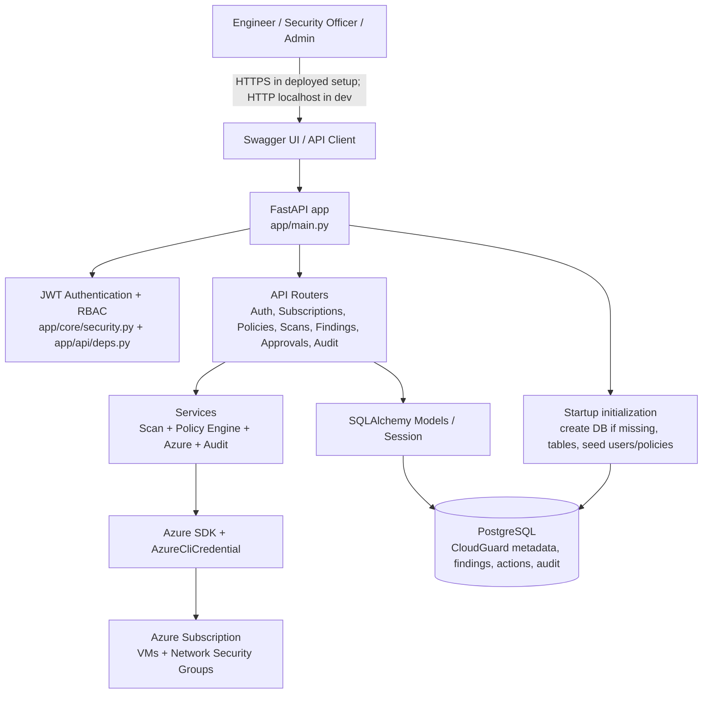
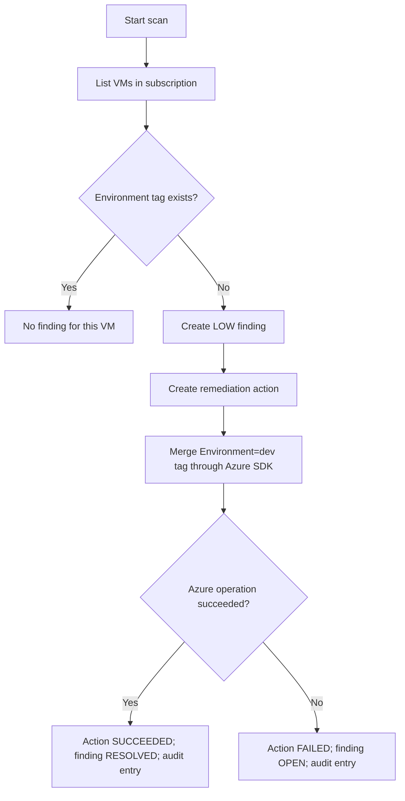
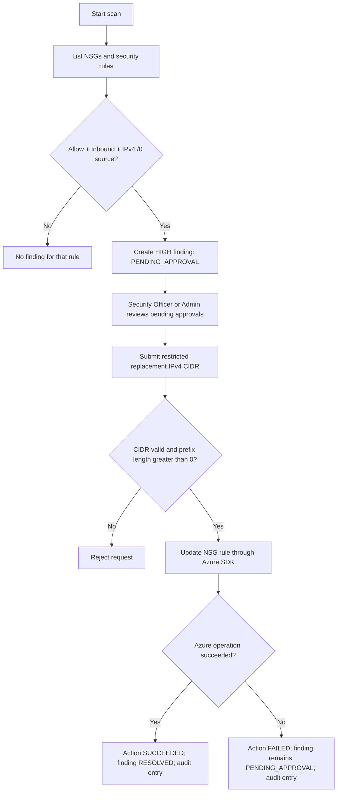

# CloudGuard — Architecture and Codebase Guide

> **Purpose:** A beginner-friendly explanation of what the CloudGuard Phase 1 code does, how its components fit together, which APIs it exposes, and how its PostgreSQL tables relate. This document describes the code in this repository; it is not a claim that every future/production feature is implemented.

## 1. What is CloudGuard?

CloudGuard is a small Azure infrastructure compliance and remediation API. It checks Azure resources against two seeded policies:

1. **Low risk — `VM_REQUIRED_ENVIRONMENT_TAG`:** If a VM does not have the `Environment` tag, CloudGuard attempts to add `Environment=dev`. Existing VM tags are intended to be preserved.
2. **High risk — `NSG_INBOUND_ANY_IPV4`:** Detects an enabled inbound NSG rule that allows traffic from `0.0.0.0/0`. The finding is marked `PENDING_APPROVAL`. A `SECURITY_OFFICER` or `ADMIN` must approve a restricted replacement CIDR before the API attempts to change the rule.

The application is a **modular monolith**: one FastAPI application/process, split into Python modules by responsibility. It is not a set of independently deployed microservices.

## 2. Architecture at a glance



### Main request flow

1. A user calls an API through Swagger or another HTTP client.
2. Protected endpoints validate the CloudGuard JWT. Role-restricted endpoints also check the user's role.
3. The route calls the relevant service or database operation.
4. SQLAlchemy reads/writes CloudGuard records in PostgreSQL.
5. For a live scan/remediation, `AzureService` uses `AzureCliCredential`, which relies on the Azure CLI session created by `az login`.
6. The API returns a response. Important operations are recorded in `audit_logs`.

**Two separate logins exist:** `az login` authenticates the Python Azure SDK to Azure. `POST /api/v1/auth/login` authenticates a user to CloudGuard and returns a JWT for CloudGuard API calls.

## 3. Runtime components

| Component | Technology | Responsibility |
|---|---|---|
| API | FastAPI + Uvicorn | HTTP routes, request validation, Swagger UI |
| Authentication | `python-jose`, `pwdlib`/Argon2 | JWT creation/validation and password hash verification |
| Authorization | `app/api/deps.py` | Resolves current user and checks allowed roles |
| Persistence | SQLAlchemy 2 + psycopg 3 | Maps Python models to PostgreSQL tables |
| Database | PostgreSQL 16 Alpine in Docker Compose | Stores users, subscriptions, policies, scans, findings, remediation actions, exceptions, audit records |
| Azure access | Azure SDK + `AzureCliCredential` | Reads VM/NSG data and performs approved changes |
| Policy evaluation | `app/services/policy_engine.py` | Pure checks for missing tags and broad inbound IPv4 sources |
| API docs | Swagger UI at `/docs` | Interactive endpoint testing |

## 4. Folder and file structure

```text
project-root/
├── app/
│   ├── main.py
│   ├── api/
│   │   ├── deps.py
│   │   ├── routes_auth.py
│   │   ├── routes_health.py
│   │   ├── routes_subscriptions.py
│   │   ├── routes_policies.py
│   │   ├── routes_scans.py
│   │   ├── routes_findings.py
│   │   ├── routes_approvals.py
│   │   └── routes_audit.py
│   ├── core/
│   │   ├── config.py
│   │   └── security.py
│   ├── db/
│   │   ├── base.py
│   │   ├── session.py
│   │   └── init.py
│   ├── models/
│   │   ├── user.py
│   │   ├── subscription.py
│   │   ├── policy_rule.py
│   │   ├── scan.py
│   │   ├── finding.py
│   │   ├── remediation_action.py
│   │   ├── exception_record.py
│   │   └── audit_log.py
│   ├── schemas/
│   │   ├── auth.py
│   │   ├── finding.py
│   │   ├── policy.py
│   │   ├── scan.py
│   │   └── subscription.py
│   └── services/
│       ├── azure_service.py
│       ├── policy_engine.py
│       ├── scan_service.py
│       └── audit_service.py
├── tests/
│   ├── test_policy_engine.py
│   └── test_security.py
├── .env.example
├── .gitignore
├── docker-compose.yml
├── pyproject.toml
├── requirements.txt
├── README.md
├── README.md                    (architecture and codebase guide)
├── README_RUNBOOK.md            (step-by-step execution guide)
└── CloudGuard_Architecture.docx (formal architecture document)
```

### What each folder does

- **`app/main.py`** — creates the FastAPI app, runs database initialization at startup, and registers all API routers under `/api/v1`.
- **`app/api/`** — HTTP endpoint handlers. They parse requests, apply authentication/role dependencies, call services, and return responses.
  - `deps.py`: reads the bearer token, validates it, loads the active user, and enforces role rules.
  - `routes_auth.py`: login and token response.
  - `routes_health.py`: basic health check.
  - `routes_subscriptions.py`: register/list Azure subscriptions.
  - `routes_policies.py`: list policies and enable/disable a policy.
  - `routes_scans.py`: start a scan and retrieve a scan record.
  - `routes_findings.py`: list findings with optional filters.
  - `routes_approvals.py`: list pending approvals and approve/execute an NSG remediation.
  - `routes_audit.py`: retrieve audit entries (Admin only).
- **`app/core/`** — application settings and security helpers. `config.py` reads `.env`; `security.py` hashes/verifies passwords and creates/decodes JWTs.
- **`app/db/`** — database connection/session, SQLAlchemy base class, and startup initialization. `init.py` checks/creates the database, creates missing tables, and seeds demo users and two policies.
- **`app/models/`** — database table definitions. Each model class corresponds to a PostgreSQL table.
- **`app/schemas/`** — Pydantic request/response shapes used by FastAPI to validate inputs and serialize responses.
- **`app/services/`** — business logic that should not be mixed into route handlers. `scan_service.py` orchestrates scanning, findings, automatic low-risk remediation, and audit events. `azure_service.py` wraps Azure SDK calls. `policy_engine.py` contains policy predicates. `audit_service.py` creates hash-linked audit entries.
- **`tests/`** — unit tests for policy predicates and security helpers. These tests do not prove live Azure permissions or real resource remediation.
- **`docker-compose.yml`** — starts PostgreSQL only; the FastAPI app runs directly in the Python virtual environment for this phase.
- **`.env.example`** — template of required settings. Copy it to `.env` and edit locally. Never commit real secrets.
- **`requirements.txt`** — Python dependencies.
- **`pyproject.toml`** — pytest configuration/project tooling settings.

## 5. Database design

At startup, `initialize_database()` runs in this order:

1. `ensure_database_exists()` checks whether the database named in `DATABASE_URL` exists. If it does not, it tries to create it; the configured DB account needs the required privilege.
2. `Base.metadata.create_all()` creates missing tables. It does not migrate or reshape existing tables.
3. `seed_initial_data()` inserts the three configured users and the two policies only when each username/policy code is not already present.

Changing `SEED_*_PASSWORD` after a user already exists does **not** reset that user's password hash.

### Entity relationship diagram

```mermaid
erDiagram
    USERS ||--o{ SCANS : triggers
    SCANS ||--o{ FINDINGS : produces
    FINDINGS ||--o{ REMEDIATION_ACTIONS : has
    USERS o|--o{ REMEDIATION_ACTIONS : requests
    USERS o|--o{ REMEDIATION_ACTIONS : approves
    FINDINGS ||--o{ EXCEPTIONS : may_have
    USERS ||--o{ EXCEPTIONS : approves
    USERS o|--o{ AUDIT_LOGS : acts_in
    USERS {
      int id PK
      string username UK
      string password_hash
      string role
      bool is_active
      datetime created_at
    }
    SUBSCRIPTIONS {
      int id PK
      string name
      string subscription_id UK
      bool is_active
      datetime created_at
    }
    POLICY_RULES {
      int id PK
      string code UK
      string name
      string resource_type
      string severity
      json config
      bool enabled
    }
    SCANS {
      int id PK
      string subscription_id
      int triggered_by_user_id FK
      string status
      datetime started_at
      datetime completed_at
    }
    FINDINGS {
      int id PK
      int scan_id FK
      string policy_code
      string resource_id
      string resource_name
      string severity
      string status
      json details
    }
    REMEDIATION_ACTIONS {
      int id PK
      int finding_id FK
      int requested_by_user_id FK
      int approved_by_user_id FK
      string action_type
      string status
      json input_data
    }
    EXCEPTIONS {
      int id PK
      int finding_id FK
      int approved_by_user_id FK
      string reason
      datetime expires_at
    }
    AUDIT_LOGS {
      int id PK
      int actor_user_id FK nullable
      string action
      string entity_type
      string entity_id
      string previous_hash
      string entry_hash
    }
```

**Important schema nuance:** `subscriptions.subscription_id` and `scans.subscription_id` are string values, not a declared foreign key. `findings.policy_code` is also stored as a string and is not a declared foreign key to `policy_rules.code`. The `exceptions` table is created by the model, but the current API routes in this phase do not expose exception-management endpoints.

### Table-by-table explanation

| Table | Why it exists | Important fields |
|---|---|---|
| `users` | CloudGuard users and their roles | `username`, `password_hash`, `role`, `is_active` |
| `subscriptions` | Azure subscriptions that an Admin has registered for scanning | `name`, `subscription_id`, `is_active` |
| `policy_rules` | Policy definitions and their settings | `code`, `severity`, JSON `config`, `enabled` |
| `scans` | One record for each scan attempt | `subscription_id`, `triggered_by_user_id`, `status`, timestamps, error |
| `findings` | Compliance issues discovered by scans | `scan_id`, `policy_code`, resource identity, severity, status, JSON details |
| `remediation_actions` | Records of attempted/completed/failed changes | `finding_id`, requester/approver IDs, action type, status, inputs/result |
| `exceptions` | Data model for approved exceptions with reason and expiry | `finding_id`, `approved_by_user_id`, `reason`, `expires_at` |
| `audit_logs` | Records security-relevant actions with a hash link to the prior entry | actor, action, entity, details, previous/current hashes |

## 6. Policies and their flow

### Low risk — VM tag



### High risk — NSG inbound rule



The approval endpoint performs both the approval record and the Azure remediation. It rejects `0.0.0.0/0` as a replacement, but it cannot determine your correct corporate/VPN CIDR. Supply only a CIDR approved by your organization. Test live changes only against a safe non-production rule.

## 7. API reference

All routes below are prefixed with `/api/v1`. Protected routes require `Authorization: Bearer <CloudGuard-JWT>` unless noted.

| Method | Endpoint | Purpose | Access |
|---|---|---|---|
| `GET` | `/health` | Health response | Public |
| `POST` | `/auth/login` | Verify username/password and issue JWT | Public |
| `GET` | `/subscriptions` | List registered subscriptions | Any authenticated user |
| `POST` | `/subscriptions` | Register a subscription | `ADMIN` |
| `GET` | `/policies` | List policy definitions | Any authenticated user |
| `PATCH` | `/policies/{policy_id}/enabled?enabled=true` | Enable/disable policy | `ADMIN` |
| `POST` | `/scans` | Start scan for a registered active subscription | Any authenticated user |
| `GET` | `/scans/{scan_id}` | Get scan status/details | Any authenticated user |
| `GET` | `/findings` | List findings; optional `status` and `severity` filters | Any authenticated user |
| `GET` | `/approvals/pending` | List findings awaiting approval | `SECURITY_OFFICER`, `ADMIN` |
| `POST` | `/approvals/findings/{finding_id}/approve` | Approve and execute NSG source restriction | `SECURITY_OFFICER`, `ADMIN` |
| `GET` | `/audit-logs?limit=100` | Read audit log, maximum 500 rows | `ADMIN` |

### Typical request shapes

Login:

```json
{
  "username": "admin",
  "password": "<password configured for this seeded account>"
}
```

Register a subscription:

```json
{
  "name": "Development Subscription",
  "subscription_id": "<Azure subscription GUID>"
}
```

Start a scan:

```json
{
  "subscription_id": "<registered Azure subscription GUID>"
}
```

Approve NSG remediation:

```json
{
  "replacement_source_cidr": "<organization-approved restricted IPv4 CIDR>"
}
```

## 8. Authentication and authorization

- Passwords are stored as password hashes (Argon2 through `pwdlib`), not plaintext.
- Login returns a signed JWT. The token includes user ID (`sub`), username, role, issue time and expiry.
- Swagger sends the token as a bearer token for protected routes.
- `get_current_user()` decodes the token and reloads the user from PostgreSQL; inactive or unknown users are rejected.
- `require_roles()` adds role checks. Roles seeded by default: `ADMIN`, `CLOUD_ENGINEER`, `SECURITY_OFFICER`.
- Seed credentials come from `.env`/settings. They are development credentials; change them before use beyond a disposable test environment.

## 9. Azure authentication and permissions

The current `azure_service.py` uses **`AzureCliCredential`**. Run `az login`, select the correct subscription, and make sure the logged-in identity has appropriate Azure RBAC permissions. This is not UAMI authentication.

Expected permission categories:
- Scan: read VMs, VM tags, NSGs and security rules in the target subscription.
- Low-risk remediation: permission to update tags at the target VM/resource scope.
- High-risk remediation: permission to update NSG security rules at the target NSG/resource-group scope.

Use least privilege and scope write permissions narrowly. CloudGuard's own roles govern who can call CloudGuard endpoints; Azure RBAC governs what the Azure identity can actually change.

## 10. Configuration variables

| Variable | Meaning |
|---|---|
| `APP_NAME` | FastAPI title |
| `APP_ENV` | Environment label |
| `API_PREFIX` | API prefix; defaults to `/api/v1` |
| `DATABASE_URL` | SQLAlchemy PostgreSQL connection string |
| `JWT_SECRET_KEY` | Secret used to sign CloudGuard JWTs; replace default |
| `JWT_EXPIRE_MINUTES` | JWT lifetime |
| `AZURE_SUBSCRIPTION_ID` | Intended subscription setting; subscription IDs are also supplied to API operations |
| `CLOUDGUARD_AZURE_MOCK` | `true` uses sample Azure objects; `false` calls Azure |
| `SEED_ADMIN_USERNAME`, `SEED_ADMIN_PASSWORD` | Initial Admin account if missing |
| `SEED_ENGINEER_USERNAME`, `SEED_ENGINEER_PASSWORD` | Initial Engineer account if missing |
| `SEED_SECURITY_USERNAME`, `SEED_SECURITY_PASSWORD` | Initial Security Officer account if missing |

`AZURE_CLIENT_ID` may remain in the template from an earlier UAMI configuration, but the current Azure service code does not use it.

## 11. Tests and current boundaries

- Run `pytest` for the current unit tests.
- Unit tests cover policy predicates and password/JWT helpers; they do not validate live Azure permissions or real remediation.
- Current scan enumerates NSGs in the registered subscription; it does not restrict the scan to NSGs attached to VM NICs.
- `Base.metadata.create_all()` creates missing tables but is not a schema migration framework.
- Audit entries are hash-linked for tamper evidence, but the database administrator could rewrite the whole chain. Production should anchor/protect logs externally.
- Scheduled scans, email notifications, more resource types, Kubernetes, and CI/CD are outside this Phase 1 implementation.
