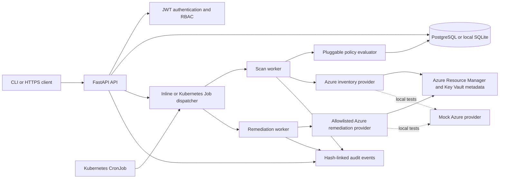
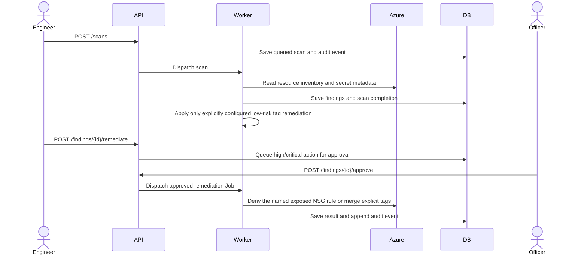
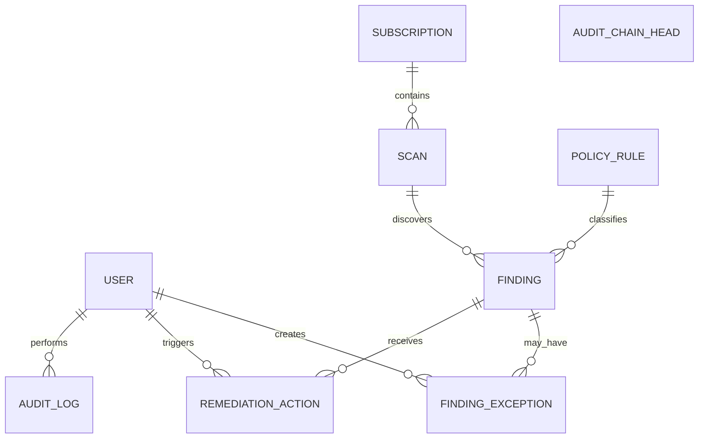

# CloudGuard architecture and data model

## Runtime architecture

In local development, scans run as FastAPI background tasks using SQLite and the deterministic mock provider. Kubernetes mode persists work records first, then dispatches separate Jobs that share the PostgreSQL database. The API service account can create Jobs but has no Azure identity. Scan and remediation workers use separate service accounts/identities so write permissions can be withheld from inventory workers. The scheduled CronJob runs `cloudguard schedule-all` and dispatches one scan Job per enabled subscription.

## Scan and approval workflows

## Entity relationships

The database stores subscription metadata and credential references only; no Azure client secret is stored in a Subscription row. `AuditLog.previous_hash` and `event_hash` link events, and a locked `AuditChainHead` serializes appends across PostgreSQL workers. This provides tamper detection, not independent immutable storage; export/anchor the chain outside the database for stronger audit evidence.
